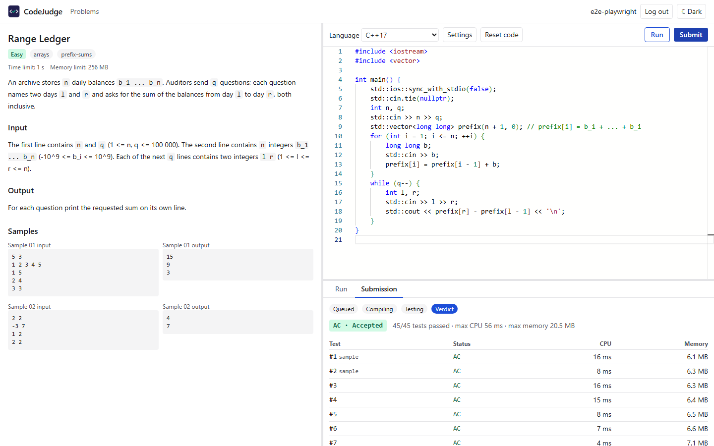
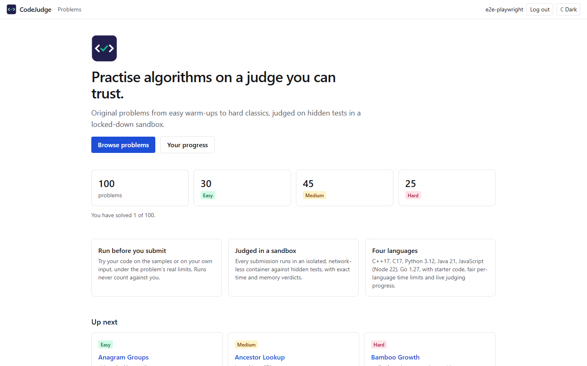
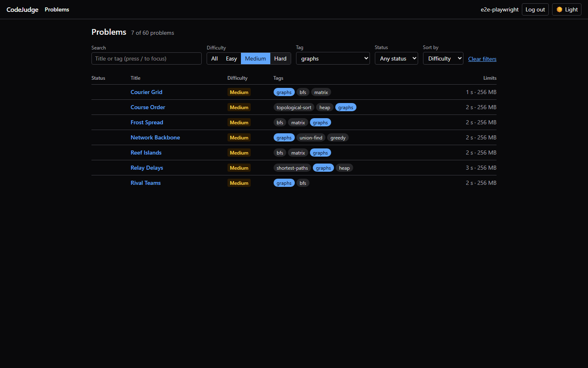
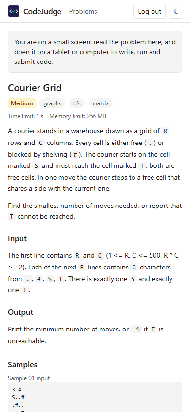
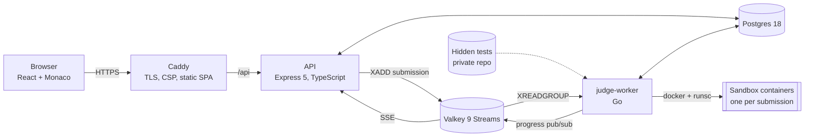

# CodeJudge

**Live: https://codejudge.dhruvgoyal.tech**

CodeJudge is an online judge for practising algorithms. It has 100 original
problems, from easy warm-ups to hard classics, and accepts solutions in C,
C++, Go, Python, Java and JavaScript. Each submission is compiled and run
against hidden tests inside a locked-down gVisor sandbox. The verdict and
each test's progress stream to the browser live.



| Landing | Problem list | Phone |
|---|---|---|
|  |  |  |

## Features

- **Problems:** 100 original problems (30 easy, 45 medium, 25 hard). Each has
  at least 45 hidden tests, generated by a seeded generator, checked by a
  validator, and cross-checked by independent C++ and Python references.
- **Editor:** Monaco, the VS Code editor, with a starter template per
  language and per-problem drafts.
- **Run before you submit:** run on the samples or on your own input, and
  see a diff against the expected output.
- **Live verdicts** over Server-Sent Events: queued → compiling → running
  test k of n → verdict, with CPU time and memory for each test.
- **Accounts:** log in with GitHub. Your profile shows solved problems and
  submission history.
- **Accessibility:** light and dark themes, and an axe-checked WCAG 2.1 AA UI
  that works on a phone.

## Architecture



- **API** (`api/`): REST and Server-Sent Events, GitHub OAuth, sessions and
  rate limits. The submission row and its queue entry are written together.
  An outbox sweeper re-queues anything that never reached the stream.
- **Queue:** Valkey Streams with a consumer group. A worker that dies
  mid-judge has its entry reclaimed (`XAUTOCLAIM`) and the submission judged
  again.
- **Worker** (`runner/`): Go. It loads problem packages, compiles and runs
  submissions in the sandbox, compares outputs with the problem's checker,
  writes results to Postgres and publishes progress to Valkey.
- **Problem packages** (`problems/<slug>/`): `problem.yaml`, `statement.md`
  and `samples/`. Hidden tests, generators and reference solutions live in a
  separate private repository and never enter this one.

## How judging works

1. **Compile** in a compile container: gcc 14 for C and C++, Go 1.27,
   javac 21. A compile error is **CE**, and its output is shown.
2. **Run in batch mode:** one run container per submission. A small init
   process, `judge-exec`, receives the program and each test's input over
   stdin, using a framed protocol ([docs/PROTOCOL.md](docs/PROTOCOL.md)).
   Between tests it runs the program fresh, resets its scratch space and
   kills every leftover process.
3. **Measure each test:** CPU time against the time limit, peak memory
   against the memory limit, and output size. A host-side wall-clock
   timeout backs this up. The whole submission also has a budget: at most
   `min(tests × time limit, 60 s)` of CPU in total, and twice that in wall
   time. The test that exhausts it is TLE.
4. **Check the output** with the problem's checker (token-wise comparison by
   default).
5. **Verdict:**
   - **AC** accepted, **WA** wrong answer;
   - **TLE** time limit exceeded, **MLE** memory limit exceeded;
   - **OLE** output limit exceeded, **RE** runtime error;
   - **CE** compile error, **IE** internal error.

   Samples run first, and only sample output is ever shown back.

Time limits are per problem, multiplied per language: ×1 for C and C++, ×2
for Go, Python, Java and JavaScript. They are calibrated so that the
reference solutions use at most half the limit.

## Security model

The code being run is hostile by assumption. Several independent layers
contain it:

- **gVisor (`runsc`).** The program's system calls go to gVisor's user-space
  kernel, not the host kernel.
- **seccomp.** An explicit, strict profile: no SysV IPC, message queues or
  `keyctl`, and no namespace creation through `clone`/`unshare`.
- **No privileges.** Every capability is dropped, `no-new-privileges` is
  set, and each container runs as a non-root uid unique to it, from a range
  no host account uses.
- **No network.** No network or IPC namespace sharing, a read-only root
  filesystem, and no host mounts: code and tests go in over stdin.
- **Limits.** Memory with swap off, CPU, a pids cgroup, `RLIMIT_NPROC`,
  capped output, and a host-enforced wall-clock timeout with forced removal.
- **Hidden tests stay hidden.** Hidden test output is never stored or
  returned; only samples show input, expected output and your output.
- **Web.** A strict Content-Security-Policy (`script-src 'self'`, Trusted
  Types) and HSTS. Sessions are random tokens stored only as SHA-256 hashes.
  Cookies are HttpOnly, Secure and SameSite=Lax, and every state-changing
  request must carry this site's Origin. Submissions are
  rate-limited and capped per user.
- **Deploy.** GitHub Actions reaches AWS through OIDC alone: no stored keys,
  and a role that trusts only `main` of this repository. Every image is
  pinned by digest. The host deploys through one SSM document and rolls
  itself back if the smoke test fails.

Details: [docs/PHASE6.md](docs/PHASE6.md) (production hardening, gVisor) and
[docs/PHASE1.md](docs/PHASE1.md) (sandbox design and isolation tests). To
report a vulnerability, see [SECURITY.md](SECURITY.md).

## Tech stack

| Part | Technology |
|---|---|
| Web | React 19, Vite 8, Monaco, TanStack Query, Tailwind CSS 4, React Router |
| API | Node 22, Express 5, TypeScript, Zod-validated config |
| Data | Postgres 18, Valkey 9.1 (Streams, pub/sub, rate limits) |
| Judge | Go 1.27, Docker Engine, gVisor `runsc`, seccomp |
| Edge | Caddy 2 (automatic HTTPS, HTTP/3) |
| Infra | AWS CDK (EC2 t3.small, ECR, SSM, S3 backups), GitHub Actions with OIDC |
| Tests | Go test (unit and sandbox integration under runc and runsc), Vitest, Playwright with axe |

## Local development

Prerequisites: Docker, Go (the `runner/` module pins go1.27.2 and downloads
it automatically), Node 22, and a checkout of the private problems repository
for hidden tests. Without it, only the samples are available.

```powershell
# 0. one-time: credentials and sandbox images
copy .env.example .env                       # then set CODEJUDGE_PG_PASSWORD
copy api\.env.example api\.env               # then set GITHUB_CLIENT_ID / GITHUB_CLIENT_SECRET (see below)
powershell -File scripts/build-images.ps1    # judge sandbox images -> sandbox/images/images.lock.json

# 1. infrastructure: Postgres + Valkey (compose project "codejudge")
docker compose up -d --wait
docker compose run --rm migrate up

# 2. connection URLs for the Go tools and the API (values from .env)
$env:CODEJUDGE_DATABASE_URL = "postgres://codejudge:<password>@127.0.0.1:55432/codejudge?sslmode=disable"
$env:CODEJUDGE_VALKEY_URL   = "redis://127.0.0.1:56379"
$env:CODEJUDGE_PROBLEMS_TESTS_DIR = "<checkout of the private problems repo>"

# 3. problems + worker (terminal 1)
cd runner
go build -o judge-admin.exe ./cmd/judge-admin; go build -o judge-worker.exe ./cmd/judge-worker
./judge-admin.exe import ../problems
./judge-worker.exe

# 4. API (terminal 2) -> http://127.0.0.1:8080
cd api; npm ci; npm start

# 5. web (terminal 3) -> http://localhost:5173 (proxies /api; use localhost, not 127.0.0.1: cookies are per host)
cd web; npm ci; npm run dev
```

**GitHub login:** create a GitHub OAuth App (Settings → Developer settings →
OAuth Apps). Set its callback URL to
`http://localhost:5173/api/auth/github/callback`, and put its client ID and
secret in `api/.env` (gitignored). The judge on its own, without the
service:

```powershell
cd runner; go build -o judge-run.exe ./cmd/judge-run
./judge-run.exe judge --problem ../problems/ledger-total --lang cpp --src my-solution.cpp
```

Tests (run each suite on its own):

| Suite | Command |
|---|---|
| Go unit | `cd runner; go test ./...` |
| Sandbox and judge integration (Docker) | `go test -p 1 -tags integration -count=1 ./internal/sandbox/ ./internal/judge/ ./internal/store/` |
| API | `cd api; npm test` |
| Service end to end | `cd api; npm run e2e` |
| Web unit | `cd web; npm test` |
| Web end to end (Playwright; starts the API, Vite and a worker) | `cd web; npx playwright install chromium; npm run e2e` |
| Infrastructure | `cd infra; npm test` |

## Deployment

The site runs on one EC2 host in ap-south-1, defined in `infra/` (AWS CDK).
The host runs Caddy, the API, Postgres and Valkey under Docker Compose, and
the worker under systemd with gVisor.

1. Every push to `main` runs CI:
   - Go, API and web tests;
   - the sandbox integration suite under runc and under runsc;
   - browser end-to-end tests;
   - a full bootstrap, deploy and rollback of the host scripts on a fresh
     Ubuntu runner.
2. When CI is green, the **Deploy** workflow builds the images, pushes them
   to ECR, and runs the `CodeJudge-Deploy` SSM document on the host. Its
   manifest pins every image by digest, plus the hidden tests' commit.
3. On the host, `deploy/host/deploy.sh`:
   - pulls the images, renders configuration from SSM Parameter Store,
     migrates the database and syncs the hidden tests;
   - restarts the services and judges a real submission as a smoke test;
   - rolls back to the previous release by itself if any step fails.

Postgres is backed up to S3 every night. Runbook (first deploy, rollback,
restore, secret rotation, teardown, time-limit calibration):
[docs/DEPLOY.md](docs/DEPLOY.md). What runs by itself and what needs a person, how often:
[MAINTENANCE.md](MAINTENANCE.md).

## Project history

The project was built in phases, each documented with its design decisions
and measurements:

- [AUDIT](docs/AUDIT.md): why the original prototype was rewritten.
- [Phase 0](docs/PHASE0.md): sandbox isolation tests.
- [Phase 1](docs/PHASE1.md): the sandbox runner.
- [Phase 2](docs/PHASE2.md): the judge engine.
- [Phase 3](docs/PHASE3.md): the service, queue and workers.
- [Phase 4](docs/PHASE4.md): the frontend.
- [Phase 5](docs/PHASE5.md): auth, limits and history.
- [5.5](docs/PHASE5_5.md): Java and JavaScript.
- [5.6](docs/PHASE5_6.md): C, Go and 100 problems.
- [Phase 6](docs/PHASE6.md): production and gVisor.

## License and contributions

- **License:** the code is [MIT](LICENSE). The problem statements, samples and
  problem metadata in `problems/`, and the images, are © Dhruv Goyal, all
  rights reserved, and not covered by the MIT license.
- **Contributions:** not accepted ([CONTRIBUTING.md](CONTRIBUTING.md)).
- **Security reports:** [SECURITY.md](SECURITY.md).
