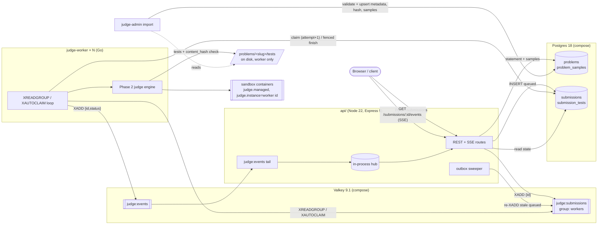

# Phase 3 — Judge as a service

Status: **complete**. Compose infrastructure, migrations, `judge-admin import`, the TypeScript API, the Go `judge-worker` and end-to-end/resilience tests are in.

All tests pass:
- API: 14 (Vitest + supertest);
- Go fencing integration: 3;
- E2E: 5 (184 s);
- every Phase 0–2 suite.

Every suite ends with 0 sandbox containers left.

## Architecture



## Components

### 3a. Infrastructure

**`compose.yaml`** (project `codejudge`):
- `postgres:18.6-alpine@sha256:77f58511…` and `valkey/valkey:9.1.2-alpine@sha256:48332870…`, each limited to 256 MB, with named volumes `codejudge_pgdata` and `codejudge_valkey`.
- Ports bind to loopback only, on non-default ports (55432, 56379), so they can't collide with the owner's other databases.
- Credentials come from a gitignored `.env` (`.env.example` is committed).
- No `judge.managed` labels.
- Valkey runs with AOF on and `noeviction`.

**Version checks** (2026-10-13):
- Postgres 19 is at beta4, not GA, so Postgres 18 is used.
- Valkey 9.1.2 is the latest stable (9.2 is an RC).

**Migrations:** plain SQL in `db/migrations/`, run by **dbmate 2.36.0** (released 2026-09-19, repository active) as a pinned one-shot compose service:
```
docker compose up -d --wait
docker compose run --rm migrate up
```

**Schema** (`20261013000001_init.sql`, `…02_enqueued_at.sql`):
- `problems`: slug, title, statement_md, time_limit_ms, memory_limit_mb, checker (jsonb), content_hash, timestamps.
- `problem_samples`: public samples only.
- `submissions`:
  - columns: uuid, problem, language allow-list CHECK, `octet_length(source) BETWEEN 1 AND 65536` CHECK, status `queued|running|done`, verdict, reason, failed_test, failed_is_sample, max_cpu_ms, max_rss_kb, **attempt**, worker_id, created/started/finished_at, enqueued_at;
  - a CHECK that `done` ⇔ verdict is set;
  - indexes on `(status, created_at)` and a partial index for the sweeper.
- `submission_tests`: PK `(submission_id, seq)`, so there can be no duplicate rows.

**`judge-admin import problems/`:**
1. Validates *every* package with the Phase 2 loader before writing anything.
2. Upserts metadata, `content_hash` and samples in one transaction per problem. The hash is a sha256 over `problem.yaml`, `statement.md` and all test files: length-prefixed, sorted, slash paths, identical on every OS.
3. Idempotent: re-running reports `unchanged`.

Hidden tests never leave the disk.

### 3b. API (`api/`)

**Stack:** Node 22, Express 5.3.0, zod 4, node-postgres (parameterized SQL only), pino, ioredis 6, TypeScript 7 for type-checking, tsx to run. The config is validated with zod at startup, and the process fails fast with every problem listed.

| Endpoint | Behaviour |
|---|---|
| `GET /health` | Postgres + Valkey ping; 503 if either fails |
| `GET /problems` | slug, title, limits |
| `GET /problems/:slug` | statement, limits, checker, **samples from `problem_samples`**. The API has no access to test files at all |
| `POST /submissions` | strict zod body `{problemSlug, language ∈ {cpp, python}, source}`, source ≤ 64 KiB **in UTF-8 bytes** (413 above) → **202 `{id}`** + `Location` |
| `GET /submissions/:id` | state + per-test rows; source is not returned |
| `GET /submissions/:id/events` | SSE: subscribe → send current DB state → every change → `verdict` event → close; 15 s keepalives; 5 s DB safety poll; 30 min max |

**POST flow (simplified transactional outbox):**
1. `INSERT` the submission (queued, `enqueued_at NULL`).
2. `XADD judge:submissions {id}`.
3. Stamp `enqueued_at`.

If step 2 fails after the insert, the row is the source of truth. A sweeper (every 10 s) claims rows that are `queued` **and not (re)enqueued within 60 s** (`FOR UPDATE SKIP LOCKED`), stamps `enqueued_at`, and re-`XADD`s them. It's "simplified" because the insert and the enqueue are not one atomic step: an enqueue can happen twice (the API's XADD lands just as the sweeper fires), but never zero times. Duplicates are harmless; see queue semantics below.

### 3c. Worker (`runner/cmd/judge-worker`, `internal/worker`)

**Stack:** go-redis v9.23 against Valkey, pgx v5.11.

**Main loop:** take a concurrency slot (default 2), then:
1. at most every `ClaimIdle/2`: `XAUTOCLAIM` one entry idle longer than **60 s**;
2. otherwise `XREADGROUP judge:submissions` (group `workers`, consumer = worker id).

**Per entry:**
1. **Dead-letter check:** if the entry has been delivered more than `JUDGE_MAX_DELIVERIES` (3) times, mark the submission IE ("dead-lettered") and `XACK`.
2. **Load** the submission; if it's missing or already `done`, `XACK` and stop.
3. **Claim:** `UPDATE … SET status='running', attempt=attempt+1, worker_id=$w, started_at=now() WHERE id=$id AND status IN ('queued','running') RETURNING attempt`. Then `XADD judge:events {id, status: running}`.
4. **Load the package from disk** and compare its `content_hash` with the DB; a mismatch gives IE with a "re-run judge-admin import" reason.
5. **Judge** with the Phase 2 engine (batch mode).
6. **Fenced finish**, in one transaction: `UPDATE … SET status='done', verdict=… WHERE id=$id AND attempt=$attempt AND status='running'` plus `submission_tests` rows. If 0 rows are affected, the worker is stale: it logs and discards the result, and **does not XACK**.
7. **`XACK` only after the commit**, then `XADD judge:events {id, status: done, verdict}`.

**Other behaviour:**
- **Heartbeat:** every 10 s, `XCLAIM … JUSTID` to itself for every in-flight entry. This resets their idle time without bumping the delivery count, so a live worker's work is never reclaimed by another worker.
- **Reaper:** at startup and every 60 s, using the Phase 2 rules (dead owner pid + start time, or older than 30 min). Sandbox containers carry `judge.instance = worker id`.
- **Shutdown:** SIGINT/SIGTERM stops reading, lets in-flight submissions finish (their context is never cancelled; the sandbox's own deadlines bound them), then exits. A second signal exits immediately.

### 3d. Events → SSE

The API tails `judge:events` with `XREAD BLOCK … $` on a dedicated connection. It uses no consumer group, because every API instance must see every event. Each event is a nudge to the in-process hub, and SSE handlers re-read Postgres.

No update is lost between page load and subscription: a handler **subscribes before reading the current state**, re-reads once right after subscribing, and also re-reads every 5 s in case events were missed while the API was down.

## Queue semantics: at-least-once + fencing = effectively-once results

- **Delivery is at-least-once.** An entry stays in the consumer group's PEL until `XACK`, and the ack happens only after the result is committed. A crash at any earlier point (before the claim, mid-judging, before the commit) leaves the entry pending, and `XAUTOCLAIM` redelivers it after 60 s of idleness. The outbox sweeper covers the gap before the first `XADD`.
- **Duplicates come from three places:** sweeper/API races, reclaim of a slow-but-alive worker (prevented in practice by the heartbeat), and a worker that crashes between the commit and the `XACK`.
- **The database decides who may write a result:**
  1. **Claim** increments `attempt`, which fences every earlier attempt.
  2. **Finish** writes only `WHERE attempt = $mine AND status = 'running'`. A stale worker's write, whether it finishes before or after the newer attempt, changes nothing; its `submission_tests` rows are in the same transaction, so nothing partial leaks.
  3. **A finished submission is never re-claimed** (`status IN ('queued','running')`), so a redelivered entry for a `done` submission is simply acked.
- **The result:** each submission gets **exactly one recorded verdict and one set of test rows**, even though judging may occasionally happen more than once. Judging is deterministic and side-effect-free (sandboxed, no network), so re-running it is safe.
- **Poison submissions** are bounded: after 3 deliveries, the next delivery dead-letters the submission as IE and acks it.

## Tests and measured numbers

| Suite | Result |
|---|---|
| API (`npm test`, real Postgres/Valkey, per-run stream names) | 14 / 14: health, problems (samples only; hidden test content absent), validation (language allow-list, empty/extra fields, 64 KiB byte limit incl. multi-byte, malformed JSON, unknown problem), submission reads, sweeper (stale re-enqueued once; fresh and recently enqueued rows skipped), SSE (done → status + verdict + close; live updates in order; event-stream fan-out; listener cleanup) |
| Fencing (`go test -tags integration ./internal/store/`) | 3 / 3: stale finish after the newer attempt rejected; stale finish *before* the newer attempt rejected and leaks nothing; same-attempt double finish and re-claim of a done submission rejected |
| E2E (`npm run e2e`, real API, real `judge-worker` processes, real sandboxes) | 5 / 5, 184 s total (below) |

**E2E results:**
- **Verdicts:** 15 submissions in parallel (AC/WA/TLE references for all 5 seed problems), 2 workers. Every SSE stream starts with the current state and ends with exactly one `verdict` event carrying the expected verdict.
- **Load:** 30 concurrent submissions (ledger-total Python AC, rising-towers C++ AC, range-ledger C++ WA), 2 workers:
  - all `done` with the expected verdict, each with `attempt = 1`;
  - exactly one `done` event per submission on `judge:events`;
  - no duplicate `submission_tests` rows;
  - both workers took part.
- **Crash recovery:**
  1. Worker A (concurrency 1, claim idle 15 s, heartbeat 3 s) is hard-killed (`TerminateProcess`) while it's mid-judging a `farthest-beacons` Python submission and its sandbox container exists.
  2. Worker B starts, its startup reaper removes A's orphaned container (A's pid is dead), and after 15 s of idleness it `XAUTOCLAIM`s the entry (delivery 2).
  3. B judges the submission as **attempt 2** and records AC with `worker_id = B`. No container labelled with A's instance remains.
- **Outbox:** a queued row inserted without `XADD` is picked up by the sweeper (`enqueued_at` stamped by the sweeper) and completes with AC.

**End-to-end latency** (small problem, idle system, 1 worker; POST → final SSE `verdict`; `ledger-total` `ref.cpp`, 11 tests; 20 sequential runs; 2.1 GB free host RAM, Docker capped at 6 GB / 6 CPUs):

| p50 | p95 | min | max |
|---|---|---|---|
| **3038 ms** | **4190 ms** | 2625 ms | 4253 ms |

That's roughly the Phase 2 batch submission time (C++ compile ~1–1.5 s, plus one batch container with 11 tests) plus the queue/DB/SSE overhead. As in Phase 2, absolute times on this Windows/WSL2 host are indicative only.

## Bugs found by the tests (fixed)

1. **Fenced `UPDATE` failed at runtime:** `CASE WHEN $5 = '' THEN NULL ELSE $6 END` was inferred as `text` for a boolean column. All parameters in that statement are now cast explicitly. The worker's own failure handling (leave pending → reclaim → dead-letter after 3 deliveries) behaved exactly as designed while this was broken.
2. **Recovery starvation:** `XAUTOCLAIM` originally ran in its own goroutine and needed a free concurrency slot. The read loop holds a slot while blocking on `XREADGROUP` and re-takes it immediately, so recovery almost never ran, and never with concurrency 1. The crash test caught it. Recovery now runs inside the read loop while holding the slot.

## Deviations from the spec

1. **Postgres 18.6**, because 19 is not GA (beta4 only).
2. **Extra `problem_samples` table.** Samples are copied into the DB at import, so the API never needs filesystem access to problem packages. That makes "hidden tests are never served" structural rather than a code-path property.
3. **Extra columns:** `submissions.reason` (IE/CE explanation; CE stores capped compiler output), `submissions.enqueued_at` (outbox), and `submission_tests.name` / `is_sample`.
4. **The sweeper condition** is "queued **and** not (re)enqueued in the last 60 s" (via `enqueued_at`), rather than just "queued after 60 s". The literal rule would re-add the whole backlog on every sweep whenever the workers are busy.
5. **Reclaim threshold:** 60 s with **heartbeats** (`XCLAIM JUSTID` every 10 s on in-flight entries), instead of "idle longer than the max submission duration". The worst-case duration is ~24 min (a 50-test batch at the 10 s maximum limit), which would make crash recovery take that long. Heartbeats keep live workers' entries fresh; fencing still guarantees correctness if a reclaim ever races a slow worker.
6. **A stale worker does not XACK.** After a fenced-out write the entry belongs to the newer attempt's delivery; acking it would remove it from the PEL while the newer attempt might still crash.
7. **Dead-letter rule:** an entry delivered more than 3 times is dead-lettered on its next delivery, i.e. three judging attempts are allowed.
8. **No consumer group for `judge:events`:** a plain `XREAD` from `$` (fan-out to every API instance), plus a 5 s DB safety poll per SSE stream.
9. **Node client is ioredis 6**, not iovalkey (0.4, pre-1.0); it's protocol-compatible with Valkey. SQL is plain parameterized `pg`; Kysely wasn't needed.
10. **`GET /submissions/:id` does not return the source.**
11. **The fencing test is a Go integration test** against the real `store.FinishFenced`, not a simulated stale worker through the API, so the actual SQL is what's tested.
12. **Graceful shutdown is implemented but not covered by an automated test on this host.** On Windows, Node cannot deliver a console Ctrl-C to a child process (`child.kill()` is `TerminateProcess`), which is exactly what the crash test uses. Cover it on the Linux worker in Phase 6.
13. **Workers run as host processes** (Windows) talking to Docker Desktop; they're not yet containerized. That's planned for Phase 6 (EC2 + gVisor).

## Follow-ups after Phase 3

Committed in `0826aba`, before Phase 4.

1. **Valkey AOF:** already enabled (`--appendonly yes`). Verified: 3 stream entries **and** the consumer group's pending entry survived `docker compose restart valkey`.
2. **Stuck `running` submissions:** the sweeper also re-enqueues `status='running'` rows whose `started_at` is older than `SWEEP_RUNNING_AFTER_MS` (default 30 min, which equals the reaper threshold and is greater than the max container lifetime of 22.5 min plus compile time), and that weren't re-enqueued within `SWEEP_AFTER_MS`. Fencing makes this safe even if the original worker is somehow alive. E2E test: a `running` row with an old `started_at` and no stream entry completes as attempt 2. The test's threshold (60 s) must exceed the judging time; with 5 s the sweeper re-enqueued the re-claimed attempt too, and fencing still produced one result, but at attempt 3.
3. **Progress events:** the worker publishes `{id, status: running, stage: compiling|testing, test: k, total: n}` to `judge:events`, throttled to ≤ 5 per second per submission (stage changes are always sent). The API forwards them as SSE `progress` events, and **replays the latest one** to a subscriber that connects mid-judging; progress isn't stored in Postgres, so without the replay a late subscriber would miss `compiling`.
4. **Sample output:** `submission_tests.stdout` (≤ 4 KiB, cut on a UTF-8 boundary, plus `stdout_truncated`) is stored for **sample tests only**. A CHECK constraint (`submission_tests_stdout_samples_only`) makes storing a hidden test's output impossible, and the API strips output fields from hidden rows. Covered by API and E2E tests.

API tests: 18. E2E: 6. Latency after the follow-ups: p50 3020 ms / p95 3292 ms (ledger-total C++, 20 runs).

5. **Design bug found by the load test: the sweeper duplicated backlog entries** (fixed during Phase 5, before 5b).
   - *Symptom:* in a slow full e2e run, a 30-submission load test ended with a submission at `attempt = 2`.
   - *Cause:* the sweeper re-enqueued any `queued` row not (re)enqueued within 60 s. That includes submissions legitimately waiting in the stream behind a backlog. It created duplicate entries, and a duplicate delivered while another worker was judging the submission re-claimed it (`Claim` accepts `running`). Fencing kept results correct, but workers wasted capacity. Since a bigger backlog meant more duplicates, more wasted judging, and more backlog, it was a positive feedback loop.
   - *Fix:*
     - New column `submissions.stream_entry_id`; the API stores the XADD entry id after a successful XADD.
     - The sweeper re-enqueues a queued submission only if `stream_entry_id IS NULL` (XADD failed) or `XRANGE <id> <id>` finds nothing (entry lost or trimmed), and records the new id. Its `enqueued_at` stamp rotates the check through a large backlog. Stuck `running` rows are handled as before.
     - The worker loads the submission first and XACKs without judging when it is already `done` or when the entry is **older** than its recorded `stream_entry_id` (logged as a duplicate delivery). This also means a superseded entry can no longer dead-letter a live submission. *Older*, not merely different: the first version skipped any mismatch, and the new lost-entry e2e test caught a race. The sweeper XADDs before it records the new id, so the worker read the new entry, still saw the old id, and dropped it. Stream ids are ordered, so a newer, not-yet-recorded entry is judged.
   - *Tests:*
     - The load test, at the original 60 s threshold, now also asserts `XLEN = 30` with each id exactly once, and `attempt = 1` for all.
     - API tests: a 10-minute-old waiting submission isn't re-enqueued; a lost entry is re-enqueued and the new id recorded.
     - E2E: lost XADD (kept); lost stream entry completes at attempt 1; a duplicate entry for a done submission is XACKed with nothing changed.

## How to run

```powershell
docker compose up -d --wait
docker compose run --rm migrate up
# .env provides CODEJUDGE_PG_PASSWORD; derive URLs:
$env:CODEJUDGE_DATABASE_URL = "postgres://codejudge:<pw>@127.0.0.1:55432/codejudge?sslmode=disable"
$env:CODEJUDGE_VALKEY_URL   = "redis://127.0.0.1:56379"
cd runner; go build -o judge-admin.exe ./cmd/judge-admin; go build -o judge-worker.exe ./cmd/judge-worker
./judge-admin.exe import ../problems
./judge-worker.exe            # one or more
cd ../api; npm ci; npm start  # API on 127.0.0.1:8080
npm test                      # API tests
npm run e2e                   # end-to-end (alone; never with the benchmark)
```
