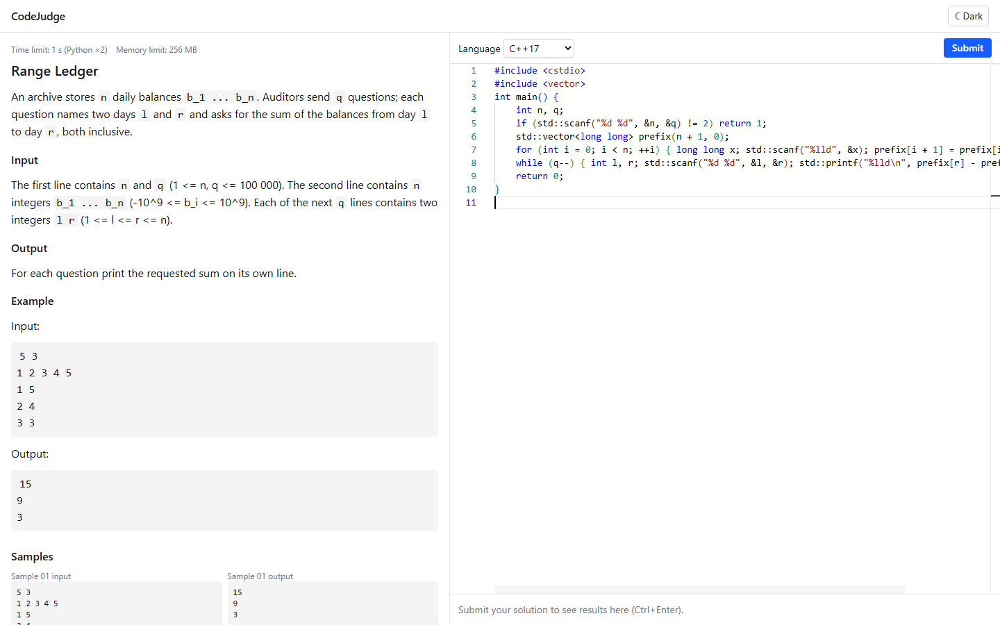
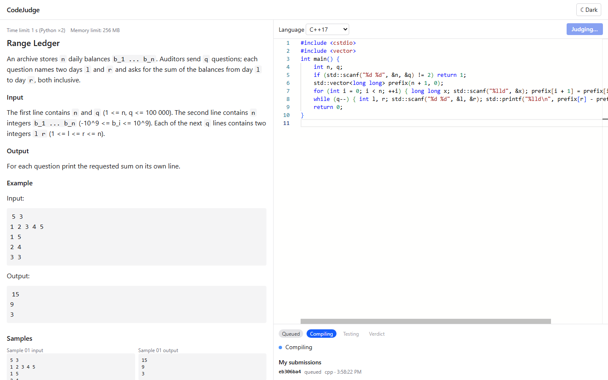
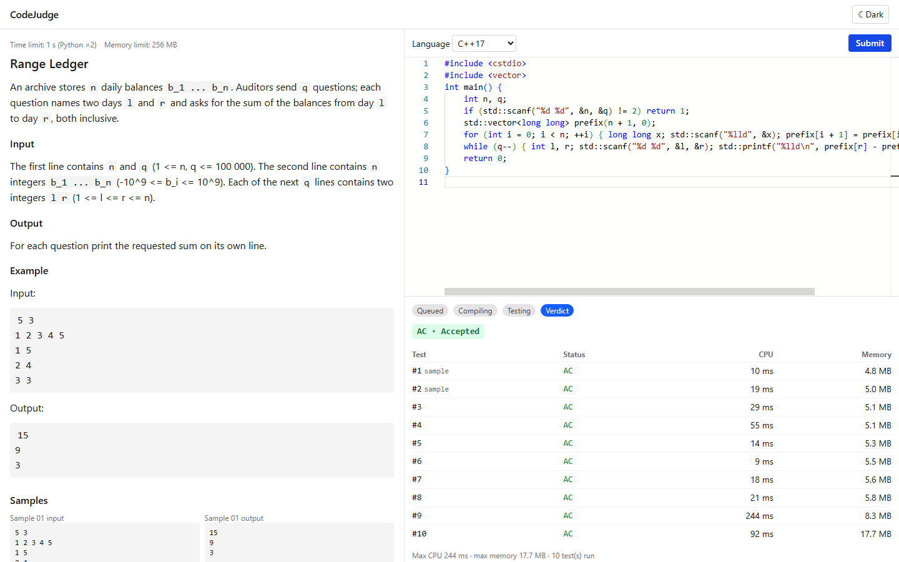
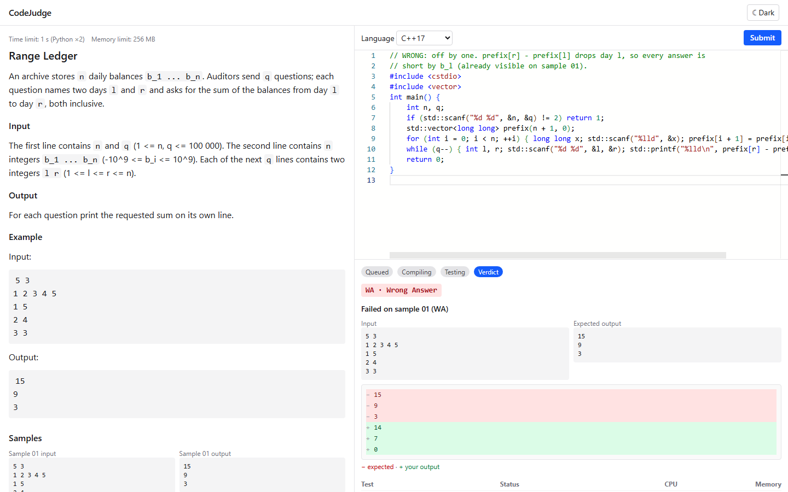

# Phase 4 — Frontend

Status: **complete**. `web/` is a Vite + React app with live judging over SSE.

Tests: **19 unit tests** (Vitest + React Testing Library) and **4 Playwright full-stack tests**, all passing. The Phase 3 follow-ups that the UI relies on are in [PHASE3.md § Follow-ups](PHASE3.md#follow-ups-after-phase-3).

## Screenshots

All four come from the Playwright run (`PHASE4_SCREENSHOTS=1 npm run e2e`) at 1440×900, against the real stack: API, Valkey, Postgres, a judge-worker and sandbox containers.

**Problem page:** statement (Markdown, no raw HTML) and samples on the left, Monaco editor (C++) and language picker on the right.

**Live stages mid-judging:** the stepper shows *Compiling*, the submit button says "Judging…", and the submission appears under "My submissions".

**Accepted:** verdict badge, per-test table (status, CPU, memory) and summary line.

**Wrong Answer on a sample:** the failed sample's input and expected output, then a line diff of expected (−) against the user's output (+). Hidden-test failures show only `Failed on hidden test #k: <status>`.

## Stack

| Piece | Version / choice | Notes |
|---|---|---|
| Vite | 8.3.4 | `@vitejs/plugin-react` 6.1.2; dev proxy `/api` → Express |
| React | 19.3.0 | strict TypeScript (TS 7.0.2, `noUncheckedIndexedAccess`) |
| Tailwind | v4.3.3 via `@tailwindcss/vite` | dark mode with the class strategy (`@custom-variant dark`) |
| Data | TanStack Query 5.104.2 | problems, problem, "my submissions" (polls until done) |
| Routing | React Router 8.4.0 | `/`, `/problems/:slug` |
| Editor | `@monaco-editor/react` **4.7.0 (stable)** + `monaco-editor` 0.57.0 | see below |
| Markdown | react-markdown 10.1.0 with `skipHtml` | raw HTML in statements is dropped, never rendered; no `rehype-raw` |
| Tests | Vitest 5.0.4 + RTL 16.3.3 + jsdom; Playwright 1.64.0 (Chromium) | |

### Dev proxy and SSE

`vite.config.ts` proxies `/api/*` to `http://127.0.0.1:8080` with the prefix stripped, so the browser sees a single origin and the API needs no CORS.

**SSE through the proxy (verified):** a script opened `/api/submissions/:id/events` *through Vite* and drove the submission through `running` → progress → `done`, 1.5 s apart. Each event reached the client within **0–20 ms** of being published (1.66 → 1.68 s, 3.17 → 3.17 s, 4.70 → 4.72 s), so nothing is buffered. The API also sends `X-Accel-Buffering: no` and `Cache-Control: no-transform` for future reverse proxies.

### Monaco: React 19 support, local bundle, size

**React 19 support:** the stable `@monaco-editor/react` 4.7.0 already declares `react: ^16.8 || ^17 || ^18 || ^19` as its peer dependency, so **`@next` (4.8.0-rc.3) isn't needed**. Stable is used.

**Bundled locally with `loader.config({ monaco })`**, no CDN, and trimmed to:
- the editor core (`monaco-editor/editor/editor.api`);
- the C++ and Python definitions only (0.57 moved them to `monaco-editor/languages/definitions/{cpp,python}/register`);
- the base editor worker (no TS/JSON/CSS/HTML language services).

The editor component is `React.lazy`-loaded.

**Bundle size:**

| Build | Main chunk | Monaco | Total assets |
|---|---|---|---|
| Before Monaco (4a scaffold) | 290.48 kB (91.77 kB gzip) | — | — |
| **After, trimmed + lazy (shipped)** | 291.13 kB (92.14 kB gzip) | lazy chunk 2,718 kB (699 kB gzip) + 99 kB CSS + 304 kB worker + C++/Python grammars 4.7 / 3.5 kB | **3.37 MB, 7 files** |
| Full `monaco-editor` import (comparison only) | 291.19 kB | ≈80 language grammars + TS/HTML/JSON/CSS workers | 14.5 MB, 99 files |
| Final app (4c, with react-markdown and pages) | 434.03 kB (135.03 kB gzip) | unchanged lazy chunk | — |

**Security:** monaco-editor 0.57 pins `dompurify` 3.4.15, which has 2 low-severity advisories affecting `IN_PLACE` mode. An npm `overrides` entry bumps it to the patched 3.4.17, and `npm audit` is clean. npm's own suggestion (downgrade Monaco to 0.56) was rejected as a breaking change.

## Pages and behaviour

- **Problem list:** title, time and memory limits.
- **Problem page:**
  - **Layout:** a split pane (statement 45% | editor + results) at `lg` and wider; it stacks vertically below that. Verified at a 768 px tablet width: no horizontal overflow, panes stacked.
  - **Statement:** limits (with "Python ×2"), the statement, and the samples.
  - **Editor:** language picker (C++17, Python 3.12), with templates per language.
  - **Drafts:** saved per problem and language in `localStorage` on every change; every storage access is wrapped in try/catch, so private mode or a full quota only means "not saved".
  - **Submitting:** the Submit button, or **Ctrl/Cmd+Enter** anywhere on the page or inside Monaco. Sources over 64 KB are blocked client-side, with a message.
- **Result panel:** a pure reducer (`src/lib/judgeState.ts`), unit-tested.
  - Stages *Queued → Compiling → Testing (test k of n, with a progress bar) → Verdict*. Progress never moves backwards, and events for other submissions or arriving after the verdict are ignored.
  - Verdict badge with long label, per-test table, max CPU and memory.
  - **Failed sample:** input, expected output, and the user's stdout as a line diff (in-house LCS with CRLF and trailing newlines normalized; notes whether the stored output was truncated at 4 KB).
  - **Failed hidden test:** only "Failed on hidden test #k: STATUS".
  - **CE:** the compiler output.
- **My submissions:** until accounts exist (Phase 5), submitted ids are stored per problem in `localStorage` (newest first, max 50). The 10 most recent are fetched with TanStack Query, polling until each is done. Clicking one opens it in the result panel.
- **Errors, handled explicitly:**
  - **API down** (network failure, 502/503/504): banner with Retry on the list and problem pages.
  - **SSE drop:** a "Connection lost — reconnecting…" notice; EventSource reconnects automatically, and on reconnect the submission is re-fetched (RESYNC), so a verdict missed while offline still shows. If EventSource gives up entirely, the client polls the REST endpoint every 3 s.
  - **413:** "Your code is too large". **400/422:** the first field error from zod. **404:** the problem no longer exists.
- **Dark mode:** a header toggle. It defaults to the OS preference, is persisted, and switches Monaco's theme too.

## Tests

| Suite | Count | Covers |
|---|---|---|
| `npm test` (Vitest + RTL, jsdom) | 19 | **Reducer:** full lifecycle labels, no backwards progress, foreign/late events ignored, reconnect + RESYNC (missed verdict recovered), RESYNC while running keeps progress, submit failure → error → recovery, double submit is a no-op. **Diff:** identical, changed, missing/extra lines, CRLF/trailing newlines, empty. **ResultPanel:** live stage + progress bar, reconnect notice, failed-sample input/expected/diff, hidden failure shows only number + status (no diff, no output), test table formatting, CE output, error alert |
| `npm run e2e` (Playwright, Chromium; run alone) | 4 | (1) list → Range Ledger → paste C++ reference → submit → live stage → **AC**, 10-row test table, entry in My submissions. (2) wrong solution via **Ctrl+Enter** → **WA on sample 01**, diff `−15 −9 −3 / +14 +7 +0`, no hidden-failure block. (3) drafts per problem/language survive reload and language switches. (4) 768 px tablet layout + dark mode persisted across reload |

**Which problem shows a sample diff:** only `range-ledger`'s wrong solution fails on a **sample** (its off-by-one shows on sample 01). The other four wrong solutions fail on hidden edge cases by design (Phase 2), so the WA-with-diff test uses `range-ledger`.

**Playwright harness:**
- `webServer` starts the API (`tsx src/server.ts`) and Vite.
- `global-setup` builds and starts a real `judge-worker` and re-runs `judge-admin import`; `global-teardown` stops the worker.
- Requires `docker compose up -d --wait`.

## Deviations

1. **Code is pasted into Monaco, not typed,** in the E2E tests (clipboard + Ctrl+V). Typing character by character triggers Monaco's auto-indent and bracket auto-closing and corrupts the source. The submitted code is byte-identical to the reference file.
2. **The API returns 400 for validation errors** (zod), not 422. The frontend handles 400 and 422 the same way, and 413 separately.
3. **"My submissions" shows the 10 most recent per problem** (up to 50 ids are stored).
4. **The diff is implemented in-house** (about 40 lines, unit-tested) rather than adding a dependency.
5. **dompurify override** (see Monaco above).
6. **Main chunk grew to 434 kB** with react-markdown and the pages. Lazy-loading the statement renderer is possible later; Monaco, the large part, is already lazy.

## Running the full stack locally

See the README ("Run the full stack locally").
